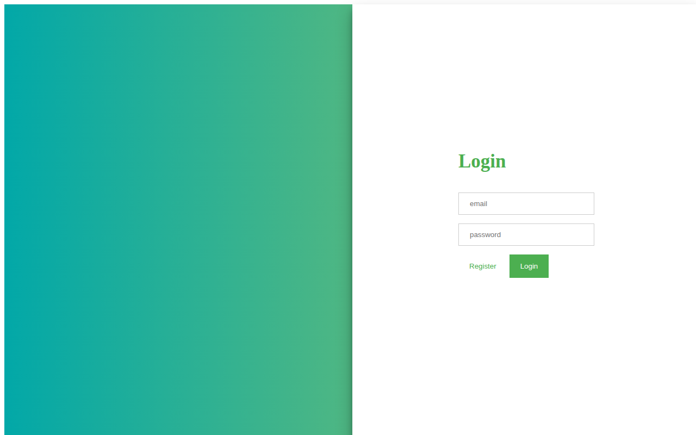

# Login / Signup Form (Sliding Panel)

A login and signup form with an animated sliding panel. Click **Login** or **Register** and the panel slides to switch between the Sign Up and Login views.


## Screenshot



## Features

- Animated sliding panel that switches between Sign Up and Login
- Sign Up form with email and password fields
- Login form with email and password fields
- Split-screen layout with a gradient panel

## Tech Stack

- HTML
- CSS
- JavaScript
- jQuery

## How to Run

Just open `index.html` in any browser. No build step, no server needed.

```bash
# or serve it locally
python3 -m http.server
# then open http://localhost:8000
```

## Notes

This is a front-end UI demo only — the forms do not submit anywhere (submission is disabled in the code) and there is no backend or real authentication behind it.
